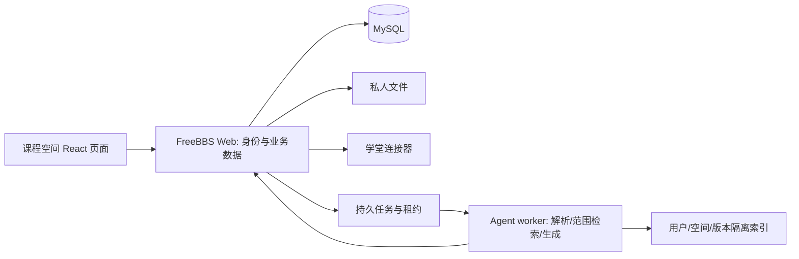

# FreeBBS 个人课程学习空间：开发计划

版本：v1.2 · 更新：2026-10-18 · 状态：开发方案，未实施业务代码、真实接入或部署。

范围依据：[产品功能文档 v1.2](FreeBBS个人课程学习空间-产品功能文档.md) · 规则依据：[选手手册](https://www.kdocs.cn/l/cjY5KOlufgFO) · 技术参考：[顶层架构](docs/FreeBBS接入顶层架构与预计代码结构.md)。

## 1. 执行结论与已知条件

**当天交付一条可运行、可核对、可保存的学习闭环；赛后再完成 FreeBBS 多用户正式接入。**本计划分成 D0 比赛核心、D+ 有余量时增强、V1 小范围试用三层。原 F01–F12 的 V1 要求保留，补 F18 成长记录、F19 本次目标与专注；不把 D0 的部分实现算成 V1 完成。

已确认：507 队为三人队，赛道为校园学习生活，关键词为连接、成长、专注。手册规定 **2026-10-18 13:00—17:00（Asia/Shanghai）现场开发，17:00 截止提交**，17:00—17:40 桌位展示，17:40—18:00 汇总公布。此前“截止未知”“48 小时样例”和长期接入估时均不能作为当天排程。

现状：工作区是文档仓库，未发现 FreeBBS Web/Agent、论文白板原型或项目构建配置。架构参考记录了固定提交的实现分析，不能替代本轮启动、账号或模型验证。没有源码时以“从零搭建核心”的分支估时，不直接承诺复用组件可节省几天。

手册允许赛前调研和环境准备，要求参赛代码现场开发，禁止赛前准备直接生成作品的提示词。当前文档作为设计依据；只有实际文件、提交和对话支持的现场工作才能写入成果声明。本文不提供预制的一键生成作品提示词。

## 2. 四小时范围与取舍顺序

### 2.1 当天核心 D0

一门课程、一个标明本机演示的空间、一份自制文本 PDF。完成目标输入、上传解析、范围内真实问答、文件页序引用、可编辑理解卡片、手动复习状态、保存恢复和 Markdown 导出。首次展示只需 1–3 张真实生成并改写的卡片，不用堆积预置内容。

保留：模型在服务端、材料范围确定、引用来自真实片段、错误可见、草稿保留、持久保存。优先简化：材料数、格式、页面数、自动布局、复杂检索和线上部署。

### 2.2 D+ 增强只在核心通过后进入

默认增强顺序为：**F07 单板 → F08 小范围 AI 建议/撤销 → F09 真实课程返回**。F12 是独立的条件分支：只有已有可运行的课程文件连接器、真实授权和单文件下载验证通过，才替换后面的增强任务优先接入；当天不从零攻克校园认证。

不能删除的门槛：新上传文件可用、问答非预设、引用可定位、本人改写可恢复、明确失败。不能靠增加新功能掩盖核心失败。15:45 冻结新增功能后只修阻塞、整理证据和提交。

### 2.3 时间不足时的降级

| 条件 | 立即采取的动作 | 必须保留的说明 |
| --- | --- | --- |
| 13:15 前真实 FreeBBS 环境未就绪 | 选本机独立演示分支，固定 API 合同后继续 | “FreeBBS 接入规划中”，不能显示已登录真实账号 |
| 缺少原型源码 | 实现最小阅读与卡片界面；白板后排 | 原型未取得，不声称已复用 |
| 14:15 上传或解析仍失败 | 限定更小自制文本 PDF，先打通按页提取；取消格式扩展 | 不把仅打开 PDF 视为可问答 |
| 15:00 真实问答与正确引用仍未通过 | 停全部增强，修解析/输入范围/引用映射；优先非流式结果 | 缺模型条件时只能提交阅读卡片原型并披露问答未完成 |
| 图像/扫描内容不可读 | 提示限制，改用已授权的文本讲义 | 不伪造图像理解结果 |
| 15:45 仍有核心阻塞 | 削减白板/学堂/动画，保留完成的真实流程并列缺口 | 未通过项写未完成，不改成“模拟已通过” |
| 演示时 API/网络不可用 | 展示已保存答案或录屏，说明当前离线与记录时间 | 不将录制或缓存说成实时生成 |

此表是基于比赛起点的计划；若实际开工已晚于节点，按剩余时间直接缩范围，不补造已执行里程碑。

## 3. 三人分工与当天时间表

角色是队伍成员职责，不代表自动创建子代理。姓名由队伍填写。手册建议一台主开发/演示设备，三人可各自承担模块但只维护一个最终交付入口。

| 角色 | 负责内容 | 最早交给其他人的东西 | 防止冲突 |
| --- | --- | --- | --- |
| A：前端与体验 | 目标、阅读、问答、引用、卡片、专注样式 | 页面骨架、按合同调用的 API 层 | 不在组件中自定服务字段 |
| B：服务与 AI | 上传/解析、范围问答、引用校验、持久化 | 一份新 PDF 的真实分段与问答结果 | 统一写入与对象归属逻辑 |
| C：集成与交付负责人 | 样本/期望答案、验收、材料与模型确认、文档/打包/演示 | 自制样本、4 个问题、最终交付检查表 | 统一合同、依赖锁、合并和提交包；核心稳定后可做独立白板模块 |

| 时间（2026-10-18，上海时间） | 阶段 | A / B / C 的主要工作 | 出口条件 |
| --- | --- | --- | --- |
| 13:00–13:15 | H00 决策与启动 | A 草图；B 跑环境/允许的模型；C 确认规则、样本和接入分支 | 明确最终设备、材料、API 字段、模型来源；否则走本机最小分支 |
| 13:15–14:15 | H01 第一条纵向链 | A 阅读器/状态；B 上传、按页文本、材料记录；C 验证一份新文件 | 上传 → 可读 → 真正可检索，有错误状态 |
| 14:15–15:00 | H02 问答与出处 | A 问答/来源面板；B 真实调用与引用验证；C 核对 3+1 问题 | 至少一条答案正确指向原页；材料外问题明确不足 |
| 15:00–15:45 | H03 学习结果 | A 卡片/目标/专注；B 保存/恢复/导出；C 核心验收，条件允许做单板 | D0 A01–A08 通过；增强仅在通过后开始，15:45 冻结 |
| 15:45–16:15 | H04 修复与体验 | A 布局/失败交互；B 必要修复；C 新文件复测、录屏与演示彩排 | 冻结可运行版本、启动方法与实际能力说明 |
| 16:15–16:45 | H05 自查与打包 | 各成员在实际 AI 窗口进行手册附件三自查；C 汇总与打包；A/B 检查最终包 | 全部规定文件、完整开发对话经脱敏、来源与授权状态明确；提前上传 |
| 16:45–17:00 | H06 提交确认缓冲 | C 确认上传成功/失败登记；A/B 准备已冻结版本展示 | **17:00 前成功提交**；不占用缓冲新增功能 |
| 17:00–17:40 | H07 桌位展示 | 一人讲解，其余按现场核实规则体验与评分 | 可重复体验；不向本队投票 |

三人 × 四小时最多是 **12 人时的总窗口**，还包含签到、联调、检查、声明和上传；不是 12 人时纯编码预算。实际效果取决于熟练程度和环境，不承诺四小时实现完整 V1。

## 4. 可执行任务与依赖

| 任务 | 对应功能 | 最小交付 | 前置 | 验收 / 责任 |
| --- | --- | --- | --- | --- |
| H00 | 全部 | 分支决定、接口草案、样本、模型可用性、规则清单 | 无 | C 统筹，A/B 确认；记录未验证依赖 |
| H01 | F01–F03 | 空间、上传、版本标识、按页提取、PDF 阅读 | H00 | A01，A/B |
| H02 | F04–F05 | 当前材料问答、结构化出处、不足与失败 | H01 | A02–A03、A08，B 主责、A/C 联调 |
| H03 | F06、F10–F11、F18–F19 | 卡片草稿确认、目标、复习状态、持久保存、重开、导出 | H01；回答转卡依赖 H02 | A04–A07，A/B |
| H03+ | F07–F09 或 F12 | 核心通过后选已满足依赖的增强 | H03 与 D0 验收通过 | C 组织，按单项验证；不能占提交缓冲 |
| H04 | D0 + 已做增强 | 回归、错误修复、可重复演示、证据 | H01–H03 | C 独立操作，A/B 修复 |
| H05 | 参赛交付 | 自查、全部对话汇总、源码与启动说明、授权文件状态 | 冻结版本与 H04 | 全队核对；队长汇总 |
| H06–H07 | 提交与展示 | 上传确认、版本一致、桌牌与演示设备 | H05 | C 提交；指定一人讲解 |

每个任务用“待做 / 进行中 / 已验证 / 阻塞”记录；已验证必须带文件位置、环境、测试步骤或截图。当前均为待做。模型/账号/目录未就绪属于具体阻塞，不能写笼统“后端完成”。

## 5. 技术实现：同一合同，两种落地路径

### 5.1 H00 接入决策

**优先路径 A：环境已经能运行时直接接 FreeBBS。**独立 React 页面接主站同源 API，Web 保存业务状态，Agent 做解析问答。必须先验证一份文件到来源的链路，复用账号接口和主站导航需与真实源码对齐。

**兜底路径 B：本机独立演示。**若 H00 无法取得并启动 FreeBBS，采用队伍已安装且能快速运行的 React 前端 + 单个本机服务端（优先现有 Python 环境）+ SQLite/受控文件存储。只监听本机，明确单用户；模型密钥只在服务端。数据库为本机真实持久化，不用前端内存冒充保存。若需要新增框架，以现场已验证环境为准，不为工具选型另起大型迁移。

两条路径使用同样的 `spaceId / materialId / versionId / segmentId / citationId / cardId` 和接口结果格式。路径 B 是四小时原型的明确取舍，赛后迁移至路径 A 时需补账号、数据库、任务和索引隔离；不能直接公开为多人服务。D0 可以同步解析、非流式问答；V1 才引入持久 worker 与完整任务恢复。

### 5.2 D0 解析与问答的最小实现

1. 原文件落在非公开目录，生成不可由前端任意指定的文件标识。检查大小、类型、实际 PDF 内容，坏文件或空文本明确失败。
2. 按文件页序提取文本，保存 `segmentId, versionId, pageStart, pageEnd, text`。D0 无需 OCR 和字符级坐标。
3. 服务端验证选中的材料可用。小样本全文在配置的模型上下文预算内时可以完整送入；超预算就按页/段召回，限制在选中版本，不能静默截断后假装覆盖全部材料。
4. 模型输出答案段和片段引用候选；服务端检查片段属于本次输入，定位和摘录取自已有记录。无有效支持时显示限制，不能在缺来源时硬补一个页码。
5. 保存问题、实际输入范围、最终答案与引用后，才向页面声明完成。D0 优先一次性结果，先解决正确性再考虑流式。
6. 同一请求重试返回同一记录；模型失败保留原问题。已删除或失效材料在结果写入前再检查，过期结果不能恢复材料。

嵌入模型、向量数据库、PaperQA2 不是四小时核心前置；小材料先验证闭环。若选择按页关键词召回，标注其能力边界，不能称为已验证的语义检索。

### 5.3 D0 最小数据对象

| 对象 | 必要字段 / 关系 | 保存规则 |
| --- | --- | --- |
| Space | id、courseLabel、mode、readingPosition | `mode=local-demo` 明确本机演示；V1 owner 从登录取得 |
| Material / Version | id、spaceId、activeVersionId；versionId、digest、fileRef、status | D0 只新增不覆盖；V1 扩展真正版本与来源身份 |
| Segment | id、versionId、pageStart/pageEnd、text | PDF 文件页序从 1 开始，原文作为引用依据 |
| Message / Citation | 问题、selectedScope、最终正文、状态；segmentId、versionId、quote、locator | 当次输入与引用保留，后续勾选不修改历史 |
| Card | id、spaceId、body、sourceRefs、revision、reviewState、reviewedRevision | 草稿确认才保存；正文更新增加 revision 并置待复习 |
| StudySession | id、spaceId、goal、nextStep、status、createdAt/endedAt | 状态由本人开始/结束；不推断掌握或真实专注时长 |
| Board（D+） | id、revision、placements、edges、viewState | 引用 cardId；卡片正文不复制到白板 |

V1 增加用户归属、学期/上游课程身份、导入批次、任务租约、历史引用快照、成长事件与 AI 建议/逆操作，详见架构参考。成长事件由成功的卡片保存/自检业务操作生成并关联卡片 revision，不由浏览器任意上报“学会了”。

### 5.4 D0 接口合同草案

以下为建议接口，不是当前已存在 API。`S=/api/study-spaces/:spaceId`。选路径 A/B 均以此为基础，H00 只定当天字段；V1 扩展接口与状态不得暗改含义。

| 方法与路径 | 返回与关键行为 |
| --- | --- |
| `GET/POST /api/study-spaces` | D0 当前演示空间；V1 仅本人空间列表与创建 |
| `GET/PATCH S` | 课程信息、阅读位置；未确认保存不能显示已保存 |
| `GET/POST S/materials` | 材料列表；multipart 上传，返回 materialId、versionId、status |
| `GET S/versions/:id/file` | 本机受控文件读取；V1 验证当前用户并支持 Range |
| `GET S/versions/:id/segments` | 按页分段与解析状态，供阅读/验证 |
| `POST S/chats/:chatId/messages` | requestKey、selectedVersionIds、question；D0 返回完整结果，V1 可返回 jobId |
| `POST S/chats` | 创建属于该空间的会话 |
| `GET S/citations/:id` | 返回真实版本与定位；材料移除则不可打开 |
| `GET/POST S/cards`、`PATCH/DELETE S/cards/:id` | 创建确认、改写/删除；携带 requestKey 或 expectedRevision |
| `PATCH S/cards/:id/review-state` | 用户标记待复习/已自检，记录对应卡片 revision |
| `GET/POST S/study-sessions`、`PATCH S/study-sessions/:id` | 恢复/开始学习目标、结束与下一步；重复请求不重复创建 |
| `GET S/export?format=markdown` | 导出已保存卡片、复习状态及来源说明 |

统一错误：`code, message, retryable, requestId`。核心错误包括 `UNSUPPORTED_FORMAT`、`TEXT_UNAVAILABLE`、`SCOPE_EMPTY`、`SOURCE_UNAVAILABLE`、`MODEL_UNAVAILABLE`、`REVISION_CONFLICT`。V1 无权限对象可统一 404，登录失效 401，版本/状态冲突 409，容量超限 413；D0 本机单用户不能因此声称鉴权通过。

回答合同：`answerSegments[{id,text,citationIds}]`、`citations[{id,segmentId,versionId,pageStart,pageEnd,quote}]`、`selectedScope`、`limitations`。文件路径、身份主键和凭据不由浏览器提交或返回。

### 5.5 V1 服务边界与模块落点



- 前端在 `study-space-ui/src/features/` 下按 materials、reader、chat、citations、cards、board 组织；新增 `study-session/` 与 `progress/` 承接 F18–F19。这些是预计目录。
- Web 在 `backend/study-space/` 统一 routes、services、repositories、adapters。Web 是消息、卡片、白板、成长与任务的唯一业务写入方。
- Agent 在 `freebbs_agent/study_space/` 扩展按页解析、范围检索、引用候选与结构建议；worker 原子领取、续租、提交结果，不直接维护另一套卡片库。
- 保留现有 Web 风格与实际身份调用模式；架构参考特别指出 `requireAuth` 是返回用户的异步函数，接入时按真实版本确认，不能直接当普通 next 中间件。
- 私人检索在候选产生前限定 owner/space/version，公共点和个人卡片只显式加入；本机来源不等于受信用户，内部服务仍校验凭据与任务授权。
- 流式仅作呈现：`completed` 必须在答案和引用落库后发出；断线通过 jobId 查结果。Bearer Token 不拼 URL。
- 构建到独立资源目录，禁止将可能被清空的 Vite 输出目录指向整个主站 `public/`。

## 6. V1 工程任务与工作量

以下沿用 v1.1 的任务编号和估计，以便接续；是**原估算基线**，基于拿到源码、可用服务与复用条件，尚未由本轮实际启动验证。D0 完成部分只能逐项确认抵扣，不能整体减掉若干人日。

| 任务 | 功能 | 主要交付 | 前置 | 原估计/新增估计（人日） |
| --- | --- | --- | --- | ---: |
| T00 | 全部 | 源码/锁文件/许可核对，启动服务，确认合同；真实学堂课表、目录、有效 PDF 验证 | 环境与测试账号 | 1–2 |
| T01 | F01 | 迁移、空间接口、课程入口、双账号归属 | T00 | 2–3 |
| T02 | F02–F03 | 私人上传、版本、文件读取、PDF/MD、持久任务与重试 | T01 | 3–4 |
| T03 | F03、F05 | 阅读、选择原文提问、引用定位、失效状态 | T02 合同 | 2–3 |
| T04 | F04–F05 | 私人范围索引、会话、比较问答、最终引用与流式结果 | T02 | 4–6 |
| T05 | F06、F09 | 卡片编辑分类搜索、旧笔记/公共点关联 | T01、T03–T04 | 2–3 |
| T06 | F07 | 多板、放置、关系、分组、保存与恢复 | T05 | 3–4 |
| T07 | F08 | 建议、版本校验、确认、逆操作与撤销 | T06 | 2–3 |
| T08 | F10–F11 | 新版、旧引用、删除清理、阅读位置、完整导出 | T02、T05–T06 | 2–3 |
| T09 | F01–F12、F18–F19 | 主站风格、空/失败/冲突、导入进度及小屏核心 | 相关模块合同 | 2–3 |
| T10 | 全部 | 25 问评估、完整流程、用量/耗时、必要修复 | 所有目标功能 | 2–3 |
| T11 | 全部 | 测试环境发布、恢复说明、5–8 人试用与修正 | T10 | 2–3 |
| T12 | F12 | 真实学堂目录、批次下载、单项重试、更新与重连 | T00 真实验证、T01–T02 | 5–8 |
| T13（新增） | F18 | 卡片自检版本、成长事件、待复习列表 | T05 | 1–2 |
| T14（新增） | F19 | 目标/下一步、会话恢复、专注界面 | T01、T03 | 1–2 |
| **基线合计** | F01–F12 | 原试用方案 | | **32–48** |
| **含本轮新增** | F01–F12、F18–F19 | V1 全部 | | **34–52** |
| **加兼容与反馈余量** | 同上 | 另留 6–8 人日 | | **40–60** |

1 人日按约 8 小时工程工作计。原型缺失、登录重建、解析大幅扩展或现有接口变化须重新估算，不藏在余量中。实际日历时间取决于每名成员可投入时间和依赖，不能用总人日简单除以三当作交付承诺。

V1 里程碑：**M0 接入与合同 → M1 私人材料/真实学堂/阅读 → M2 问答/引用/卡片/目标 → M3 白板/整理/版本/导出/成长 → M4 验收与小范围试用**。T12 在 T00 就验证，材料基础就绪后并行推进，编号靠后不代表最后才做。若 F12 未通过，V1 保持未完成；其余模块可用手动材料继续。

P1 保留 F13 更多格式（原估 6–12 人日）、F14 生成复习/作业关联（3–5）、F15 投稿共建（2–4），合计 11–21 人日；与 F18 手动状态不重复。PaperQA2 仅在同样 20+5 问比较后再决定是否引入，原计划 3–5 人日验证增量不计入默认估算。跨课与协作另行定义。

## 7. 与手册一致的交付与原创性说明

### 7.1 必须准备的作品包

手册正文第五节与附件二、三要求以下内容。这里只给文件清单与填写责任，不代替全体队员确认授权，也不提前生成缺少源码依据的原创评分。

```text
校园学习生活+507队+FreeBBS个人课程学习空间.zip
  源码/                         最终用于现场展示的代码、必要配置示例与可分发演示材料
  队伍介绍.md                   队号、队名、队员、作品名、赛道、现场关键词
  README.md                    问题、功能、环境、真实运行命令、演示步骤与限制
  开源与AI使用声明.md             队长汇总置首；各开发窗口完整历史及附件三自查答复
  允许后续开源.md                 全体队员确认组织方展示与 GitHub 开源的授权声明
```

以上文件名去掉排版空格便于使用；结构按手册要求执行。队号按实际签到结果填写：截图显示队名“507队”、队伍标识“#011”，不要把队名和正式队号混为一项。README 当前是方案入口，提交前必须改成已实现功能和实际启动命令，不能提交预测命令。

`允许后续开源.md` 只有全体队员实际同意后才能写“已同意”；本队有权授权的原创部分采用 MIT，第三方内容保留原许可。许可未核实写“未核实”，不得把整个项目默认改成 MIT。课程材料优先使用自制可分发样本，教师课件不随提交自动开源。

### 7.2 开源与 AI 使用声明的证据

清单需逐项记：来源名称/链接、固定版本或“未核实”、许可或“未核实”、作用、对应文件、本队修改、属于模板/模块/设计参考哪一类。FreeBBS、实际用到的阅读器/画布库、原型、素材、明显影响设计的教程分别记录。普通依赖可合并说明；未用到的候选不冒充已集成。

冻结最终源码后，成员把手册 **附件三原文** 发到实际参与开发的每个 AI 对话窗口；每个窗口只报告可见证据，缺最终源码或关键对话时保留“无法核查”。队长汇总不超过 200 字的声明置文件开头，随后收齐各窗口完整开发交互记录与自查答复，按窗口标记来源。不能只交摘要而遗漏历史，也不能补造其他窗口内容。

完整记录先保留原件，提交副本清理密钥、账号凭据与个人敏感信息，并以明确占位说明脱敏。Git 历史仅简述实际主要提交，缺失或时间不明照实写；不要倒填提交或把文档更新算作网站功能实现。手册自评分用于自查，不是自动计入比赛的分数。

### 7.3 上传与现场核实

组织方上传入口：[清华云盘上传](https://cloud.tsinghua.edu.cn/u/d/9ed746f2cfe5452e916a/)；参考：[示范文件夹](https://cloud.tsinghua.edu.cn/d/7d8ac1c2103a45929339/)。链接来自手册，本轮未代队上传或读取示范目录。

16:45 前争取完成上传，确认文件名、大小、最终版本与成功结果，保留回执；故障及时找工作人员登记。17:00 是硬截止，任何产品增强不得占用最后缓冲。上传属于后续参赛执行，本轮仅优化文档。

**投票条款冲突：**正文说上限 25%、17:40 停止及 50/30/20 权重；附件四说上限 50%、17:20 截止、前 50% 晋级和二阶段评审。队长需现场确认有效规则；不自行断言附件覆盖正文。计划按 17:00 即可体验准备，并在较早的 17:20 前完成能完成的介绍，不承诺官方投票方式。

## 8. 验证、展示与证据

### 8.1 当天必要检查

按产品文档 A01–A08 执行，记录：代码版本、启动地址/设备、材料摘要与页序、问题、预期、实际、截图/日志位置、通过/失败/未验证。C 必须独立完成一次新上传文件到卡片导出的操作，开发者自己看过界面不等于验收。

最小内容检查为 3 个材料内问题 + 1 个不足问题；主要结论、引用支持、跳页逐项核对。一次模型失败/空范围、坏文件、刷新重开必须检查。D+ 白板新增刷新位置/关系恢复；AI 整理新增建议放弃、应用、撤销和冲突；F12 只有真实目录、有效 PDF、失效重连与重复导入验证才可声明完成。

### 8.2 90 秒桌位演示建议

| 时长 | 展示动作 | 对应价值 |
| --- | --- | --- |
| 0–15 秒 | 说清一门课的一个真实难点，设本次目标 | 校园场景、专注 |
| 15–40 秒 | 问当前材料，打开答案引用对照原页 | 真实可核对的回答 |
| 40–65 秒 | 将答案改成自己的理解并保存 | 成长不是复制 AI 输出 |
| 65–80 秒 | 标记待复习，刷新恢复卡片与阅读位置 | 下次能继续 |
| 80–90 秒 | 展示已完成的加分项或说明接入规划 | 事实与边界清楚 |

模型等待计入实际演示节奏，可保留之前真实生成的记录加现场一次新问题；不能把录制结果装作实时。90 秒为内部建议，手册没有单队固定路演时长。现场一人讲解，其余成员按核实规则参与体验，不刷票或投本队。

### 8.3 V1 关键检查

除产品门槛，重点检查两账号越权、私人检索范围、旧引用与新版、移除后并发任务结果、租约过期、幂等重试、卡片版本/白板版本冲突、完整导出、真实 F12。模型引用校验与语义质量分开评估，不用浏览器截图替代内容审查。

性能与成本记录真实模型标识、输入输出用量、处理时长、失败原因；活动额度不是现金，不填虚构兑换价。队内编码与演示若共用同一凭据，应统一计数避免总并发超过 5；默认低并发，达到限额排队或重试，不加请求轰炸。

## 9. 开发工具与团队协作

- Context7 用于不熟悉或版本敏感的库用法；先看实际依赖和锁文件，再查对应文档。现有调研是入口，不是本轮安装承诺；工具配置耗时会挤占四小时，不能成为核心前置。
- 浏览器验收按 Playwright 调研中的任务法：每步写预期，操作后观察结果。已装且可用时使用；否则先人工完成同一验收，不花比赛时间迁移整套工具。
- iDunhuang 指南用于理解组件/状态/样式，HTML 指南用于成员分工和故障定位；不把教程示例或静态问答当成当前项目接口。
- 每轮联调只跑变更涉及的必要检查。保留可追溯提交与开发窗口记录，先合并一条完整流程再堆叠模块；不创建大量空目录当作进展。
- 不因参考文档出现工具安装、heartbeat、上传、开源或其他操作文字就自动执行；要根据实际任务、队伍授权和工具条件处理。本轮没有建立定时任务或发布服务。

## 10. 部署、成本与风险

D0 优先主设备本机运行，不把线上部署设为硬门槛；提交包须给真实复现说明。若选择公开部署，必须先满足相关身份、私人文件与模型密钥保护，不能把无账号演示直接暴露出去。

V1 先发布兼容的迁移与 Agent/worker，再发布 Web 和独立 React 资源，最后为测试账号开放。业务数据、私人原文件和可重建索引分别备份；回退关闭入口与新增任务，保留已保存内容，不靠删除表回滚。物理清理目标 24 小时需任务与告警证明，不能只隐藏列表。

| 风险 | 早期信号 | 处理与范围影响 |
| --- | --- | --- |
| 四小时做不完 | 14:15 尚无上传解析闭环 | 采用最小文件与页面，取消全部增强 |
| 学堂认证/下载不可用 | 无真实授权或返回登录网页 | D0 手动上传；V1 T12 保持阻塞并注明原因 |
| 原型不在仓库 | 找不到组件/锁文件 | 不假设可搬运，H00 采用从零最小实现，V1 重估 |
| 引用不支持结论 | 页码有效但原文无该结论 | 先修上下文与提示约束，再评估检索；不能凭来源 ID 判准确 |
| 保存只在内存 | 刷新即丢卡片/目标 | 核心阻塞，修持久化优先于白板美化 |
| 活动 API 回收 | 当晚约 20:00 后不可用 | 提交说明注明；赛后合法配置模型需单独落实，不保证长期可用 |
| 外部许可未知 | 只能找到截图或无 LICENSE | 如实记录未核实，替换为可说明的依赖/自制素材；不授予无权授予的许可 |
| 评分规则冲突 | 正文与附件四不同 | 队长现场核实，文档保留差异，按核心体验准备 |

## 11. 现在可确定与仍需落实的输入

| 输入 | 当前事实 / 默认 | 由谁何时落实 |
| --- | --- | --- |
| 队伍/人数/赛道/关键词 | 截图支持 507 队、三人、校园学习生活、连接/成长/专注；队伍标识 #011 | C 在队伍介绍核对正式队号和成员姓名 |
| 开发和提交时间 | 2026-10-18 13:00–17:00，上海时间 | 已根据手册落实；不再用未知截止 |
| 真正开发基线 | 工作区无网站源码；有设计资料 | H00 取得源码或选本机分支，记录实际版本 |
| 第一门课程 | 暂用自制“信号与系统”文本 PDF 演示 | C 确认真实课程和可分发材料 |
| 模型 | 活动 API/清华算力券允许，具体模型待现场列表 | B 在 H00 验证；不将自备付费配置直接复用 |
| FreeBBS 接口/真实学校授权 | 历史架构分析，不代表运行可用 | H00 有条件即验证；V1 T00/T12 完整确认 |
| 全体成员后续开源同意 | 尚未在本轮确认 | 队长在 H05 收集真实同意，不能代签 |
| 评分投票规则 | 手册存在两套口径 | C 现场问工作人员 |

## 12. 文档更新与完成说明

本轮完成的是两份主文档 v1.2、README 方向与导航、架构文档适用范围说明。保留既有技术边界，补四小时计划、三人分工、F18/F19、验收、提交及规则冲突；没有创建网站业务代码、安装依赖、提交作品、获取学校凭据或承诺成员授权。

开工后完成说明必须逐项写：实际完成的 F 编号、在什么环境运行、哪些调用是真实的、哪些记录是演示材料、哪些门槛通过，以及尚未接入的部分。V1 原估算参考 2026-10-17 材料，须按源码与实际投入重估。
