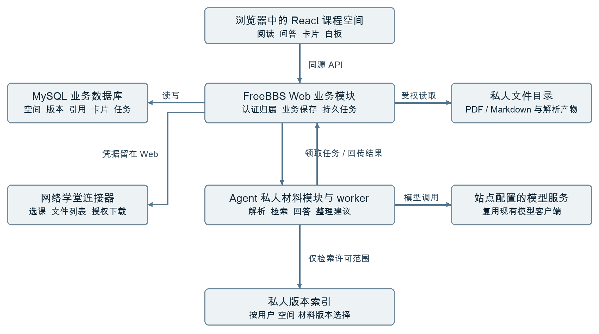

# FreeBBS 接入顶层架构与预计代码结构

个人课程学习空间的模块划分 数据流与协作指南

适用对象：黑客松小组　整理日期：2026年10月17日

> **2026-10-18 适用范围更新：**本文主体保留 v1.1 的正式接入技术设计，供赛后 V1 使用。当天四小时 D0、三人排程、F18 成长记录、F19 目标与专注及手册提交要求，以 [产品功能文档 v1.2](../FreeBBS个人课程学习空间-产品功能文档.md) 和 [开发计划 v1.2](../FreeBBS个人课程学习空间-开发计划.md) 为准。D0 可采用明确标注的本机单用户方案；V1 仍需完整 F01–F12，并增加 F18–F19。本文源码结论是 2026-10-17 固定版本记录，本轮未重新验证远端。对应 `.docx` 为历史阅读副本，未同步此次范围说明。

## 1 推荐方案与本次设计依据

**建议在 FreeBBS 中增加一个 React 课程空间页面，由现有 Web 服务统一处理身份、权限和持久数据；扩展现有 Agent 处理私人材料、范围内问答和白板整理。**先划分职责、确定数据与接口，再按模块建立文件，不重写整个 FreeBBS。

### 1.1 本次目标按同学的新要求确定

本文原设计依据是两份主文档 v1.1；当前主文档已更新为 v1.2。目标已从论文阅读演示扩展为“个人课程学习空间”：课程入口、PDF/Markdown 材料、阅读与出处、问答、理解卡片、个人白板、AI 整理与撤销、公共知识点关联、版本、导出，以及网络学堂课程文件导入。

**F01—F12 都属于试用首版 P0，网络学堂一键导入也在其中。**比赛演示可以先交付局部流程，但不能因此把试用首版要求改为已完成。[L1][L2]

### 1.2 已确认与暂定设计分开阅读

| 标记 | 本文含义 | 例子 |
| --- | --- | --- |
| 已核对 | 已读取仓库文件中的实现 | Web 使用 Express，Agent 使用 Flask |
| 需求规定 | 同学文档提出的目标 | 私人材料、F12、版本与撤销 |
| 建议新增 | 预计需要写的文件与接口 | study-space-ui/、私人材料 API |
| 待验证 | 需要真实服务或原型才能确认 | 学堂登录、课件下载、组件可移植性 |

源码核对固定到 Web 提交 a51f90fd6e4b6637a6b595c88686003847a64b31，以及 Agent 提交 5fb7651c192d1034bc3a30022947d05994ec14e9。此次读取时，两个仓库 main 与上述提交相同。[S1][S2]

当前 EEHackthon 工作区中能看到两份需求文档和学习资料，未看到需求中提及的 frontend/src、FastAPI、SQLite、PaperQA2 原型源码。因此，下文“复用阅读器与白板”是实施方向，具体组件是否能直接迁移仍需拿到原型后检查，不当作已验证能力。

### 1.3 顶层架构需要回答的五个问题

1. 用户完成什么流程，各功能属于哪个模块。
2. 哪个服务拥有账号、材料、引用、卡片、白板和任务。
3. 一次操作如何经过页面、Web、Agent 和存储。
4. 数据怎样保持私人归属、版本与失败后的可恢复性。
5. 各组员依据什么接口并行开发，怎样证明整体可用。

本文是设计与学习文档，文件树和新增接口是预测方案，尚未创建业务代码或改动 FreeBBS 仓库。

<!-- pagebreak -->

## 2 现有 FreeBBS 能复用什么

### 2.1 两个仓库的实际职责

| 现有位置 | 已核对的作用 | 接入时的处理方式 |
| --- | --- | --- |
| Web server.js | 静态服务、页面路由、API 转发 | 增加课程空间入口和独立资源路径 |
| Web public/ | 原生 HTML、CSS、JavaScript 页面 | 保留主站，单独构建新增 React 页面 |
| Web backend/server.js | Express 入口、认证、模块挂载和 AI 接口 | 只挂载新模块并注入既有依赖 |
| backend/learning-workspace.js | 基于课程知识点的个人记录与评注等 | 通过适配器关联，避免另存无关联副本 |
| backend/course-upload.js | 课程资料上传及公共文件下载 | 不把私人材料塞入公共下载链路 |
| backend/tsinghua-connectors/ | 授权、凭据隔离与现有同步流程 | 扩展课程文件目录与下载能力 |
| Agent freebbs_agent/app.py | Flask 路由、请求检查、流式响应 | 挂载独立的私人空间内部接口 |
| Agent rag_agent.py 与 rag/ | 公共课程检索、模型调用与索引管理 | 复用基础工具，新增私人范围选择 |

这些职责根据固定提交的源码核对，相关链接见第 16 节。[S3]—[S10]

### 2.2 四个容易误判的接入点

**已有学习记录，不等于已有私人材料空间。**learning-workspace.js 管理知识点下的记录；它不能直接替代材料版本、文件解析、私人索引和白板放置的数据模型。

**已有上传，不等于适合保存私人课件。**course-upload.js 中的公共资料列表和文件下载没有按本次个人空间归属鉴权。私人文件需要新通路，每次读取包括 Range 请求都验证归属。[S5]

**已有 RAG，不等于已支持多用户私人检索。**现有 RagAgent 使用配置的索引与 metadata；搜索接口为 search(query_vector, top_k)，没有本方案要求的用户、空间与选定版本过滤参数。不能仅给请求添 ownerId 就宣称隔离完成。[S8]

**已有学堂连接，不等于课件一键导入已经完成。**连接器文档区分固定样本验证与真实账号验收；现有课程、公告和作业同步也不能直接证明课程文件目录与下载可用。F12 必须单独验证。[S6]

### 2.3 认证接入要遵守现有实现

Web 的 requireAuth 是异步函数，成功时返回用户对象，失败时写响应并返回空值；它不是可以随意直接塞入 Express 中间件链的普通 next 型函数。新路由应沿用现有模块的调用模式。空间归属使用服务端查得的用户主键，不能采信浏览器自报的 ownerId。[S4]

<!-- pagebreak -->

## 3 整体架构与运行边界



### 3.1 图中每一层负责什么

**React 页面：**显示材料、阅读器、引用、卡片和白板；收集操作并展示保存、处理和错误状态。浏览器只访问主站同源业务 API。

**FreeBBS Web：**确定当前用户，检查空间归属，保存全部业务记录，管理私人文件，创建与调度任务；对外返回统一格式。网络学堂登录与下载继续由 Web 连接器负责。

**FreeBBS Agent：**接收受信任的内部任务，解析材料、构建受限索引、检索并生成带出处回答，提出白板整理建议。复用站点模型配置与现有模型客户端。

**持久存储：**MySQL 是业务记录的事实来源；私人目录保存原文件和必要解析产物；私人索引目录保存可重建的检索产物。它们都不能放入公开静态资源目录。

### 3.2 服务数量与模块数量不同

首版采用现有 Web、Agent，加一个明确启动的处理 worker 即可。worker 是执行耗时任务的独立工作进程，复用 Agent 仓库代码，并不是再开发一套独立产品 API。每个功能文件夹不需要各自成为一个服务器。

单个 Web 业务模块内部继续按“路由 → 业务服务 → 数据访问”拆分。独立的学习空间模块便于维护，也能在不改变现有社区与公共课程流程的情况下渐进接入。

### 3.3 初始部署假设

Web、Agent 和 worker 先同机运行，复用现有本机或 Unix Socket 通信方式；目录共享必须明确授权与路径映射。异机时，再把文件读取改为受认证的内部文件服务或受控对象存储。

同机运行不能代替身份校验。当前 Agent 限制非本机访问，但新增私人接口仍须校验内部服务凭据及任务授权；不能认为请求来自 localhost 就天然属于某个学生。[S9]

<!-- pagebreak -->

## 4 从需求推导模块的方法

### 4.1 第一步 写出一条贯穿产品的流程

进入课程空间 → 导入或上传材料 → 阅读 → 选范围提问 → 打开出处 → 改写为卡片 → 放入白板 → 整理并确认 → 保存后继续。

流程中每个需要保存的对象，通常意味着后端要有明确的数据模型；每个等待较久的动作，通常需要任务状态；每个跨服务动作，都需要明确输入、结果和失败责任。

### 4.2 第二步 把首版要求分配到模块

| 功能要求 | 页面模块 | Web 模块 | Agent 或外部依赖 |
| --- | --- | --- | --- |
| F01 课程空间 | 空间页与课程入口 | spaces、access | 现有账号与课程 |
| F02、F10 材料与版本 | materials、任务列表 | materials、versions、jobs | 文本提取与索引 |
| F03 阅读定位 | reader、selection | 私人文件与片段读取 | 页码或段落产物 |
| F04、F05 问答与出处 | chat、citations | chats、scope、citations | 私人检索与回答 |
| F06、F09 卡片与关联 | cards、知识点入口 | cards、course-adapter | 公共课程读取 |
| F07 白板 | board | boards、revision | React Flow 与布局工具 |
| F08 整理撤销 | 建议预览与确认 | proposals、apply、undo | 结构化整理建议 |
| F11 导出 | 导出入口 | export | 无需模型 |
| F12 学堂导入 | 学期课程与文件选择 | learn-import、connector | 学堂真实目录与下载 |
| F18 成长记录（v1.2） | 待复习列表、自检状态 | cards、review-events | 无需模型自动评分 |
| F19 目标与专注（v1.2） | 目标、下一步、收起侧栏 | study-sessions | 无需新增外部服务 |

### 4.3 第三步 为每种数据指定唯一的保存责任

卡片正文由 cards 管；白板只保存 cardId、位置、分组和连线。消息保存当时的范围；引用指向具体材料版本；任务只引用输入，不把来源含义藏在一段随意拼接的提示词里。

### 4.4 第四步 先约定接口 再制作模拟结果

前后端先共同写请求与响应示例，明确空状态、失败和冲突。前端可按约定用模拟数据推进界面；联调时替换 API 适配器。模拟结果应保持相同字段和状态规则。

### 4.5 第五步 再落到文件与测试

例如“用户把回答改成卡片”会涉及 CardEditor、cards API、cards.service、cards.repository，以及来源关联；“只改卡片标题字体”主要涉及卡片组件样式。用操作跨越的职责决定改哪些文件，而不是按文件后缀猜功能。

<!-- pagebreak -->

## 5 预计前端文件结构

以下全部是建议新增的源文件，不是当前 FreeBBS 已有目录。使用 TypeScript 与 React 承接阅读器和白板；主站原生页面保留。

```text
freebbs-web/
  study-space-ui/
    package.json                 前端依赖和构建命令
    vite.config.ts               资源路径与开发代理
    index.html                   React 页面源入口
    src/
      main.tsx                   挂载 React
      App.tsx                    组合课程空间
      api/
        client.ts                同源请求与认证适配
        studySpaces.ts           按合同封装业务请求
        jobs.ts                  任务查询与流式连接
      contracts/
        studySpace.ts            接口类型 从合同生成或对齐
      features/
        space/SpaceShell.tsx     三栏布局与空间切换
        materials/MaterialList.tsx
        materials/ImportDialog.tsx
        materials/LearnImportPanel.tsx
        reader/PdfReader.tsx
        reader/MarkdownReader.tsx
        reader/SelectionToolbar.tsx
        chat/ChatPanel.tsx
        chat/ScopePicker.tsx
        citations/CitationPanel.tsx
        cards/CardLibrary.tsx
        cards/CardEditor.tsx
        board/BoardCanvas.tsx
        board/OrganizePreview.tsx
        export/ExportButton.tsx
      state/
        workspaceStore.ts        当前选择与界面状态
        boardStore.ts            位置 连线 待保存改动
      styles/
        tokens.css               对齐 FreeBBS 视觉变量
        workspace.css            布局与组件样式
      workers/layout.worker.ts   需要时执行本地布局
      tests/                     关键界面与交互检查
```

### 5.1 哪些状态应保存在哪里

选中标签页、弹窗开关放在页面状态；待编辑卡片与未保存白板操作放在相应模块。已保存卡片、任务状态和材料版本以服务器为准，不能让浏览器 localStorage 成为多人网站唯一存储。

API 请求集中在 api/，避免每个组件各自处理 Token、错误和重试。当前主站使用 Bearer Token，新页面通过薄适配层复用现有登录约定；不额外开发注册登录系统。[S4]

### 5.2 源码和发布产物分开

源码先构建到 study-space-ui/dist/，再由专用脚本放置 public/study-space.html 和 public/study-space-assets/。不要把 Vite 可清空的输出目录直接设成整个 public/。页面入口暂定 /study-space?course=<slug>，与维护者确认后定稿。

<!-- pagebreak -->

## 6 预计 Web 后端文件结构

保留当前 Node.js CommonJS 风格和 MySQL。新增文件先用 .js，与现有后端保持一致；不把全站迁移 TypeScript 当作本功能前置工作。

```text
freebbs-web/
  backend/
    server.js                    既有入口 只增加模块挂载
    study-space/
      index.js                   创建模块并注入依赖
      routes.js                  业务路由 请求与响应
      access.js                  当前用户与空间归属检查
      schemas.js                 参数与结果校验
      services/
        spaces.js                空间创建与阅读位置
        materials.js             上传 版本 移除
        imports.js               学堂导入批次与逐文件进度
        chats.js                 问答范围 消息与引用
        cards.js                 卡片正文与来源关联
        boards.js                白板保存与版本冲突
        proposals.js             建议 应用 逆操作
        export.js                Markdown 与 JSON 导出
        jobs.js                  持久任务 领取 重试 结果
      repositories/
        spaces.js                空间数据库访问
        materials.js             材料 版本 片段访问
        learning.js              会话 引用 卡片访问
        boards.js                白板与整理历史访问
        jobs.js                  任务与租约访问
      adapters/
        agent.js                 内部模型与处理通信
        course.js                公共知识点和既有记录
        learn-files.js           对接学堂授权文件客户端
        storage.js               私人文件路径与读取
      internal-routes.js         worker 任务与结果通路
    tsinghua-connectors/
      learn-file-client.js       建议新增 目录与下载
  database/migrations/
    <下个可用编号>_study_spaces.sql
  scripts/build-study-space-ui.mjs
  docs/study-space/
    architecture.md
    api.openapi.yaml
    acceptance.md
```

### 6.1 三层各用一句话区分

routes 把 HTTP 请求转换成业务调用；services 执行“谁能做什么、状态怎么变化”的规则；repositories 负责参数化 SQL 和事务。adapters 对接现有站点、Agent 和存储，避免业务直接依赖远端返回格式。

数据写入规则只在一个业务模块中实现。不要在 routes、Agent 回调和前端各自写一套“卡片保存”规则。树中每一层是职责分组；初期同类小函数可以共用一个文件，变复杂后再拆。

<!-- pagebreak -->

## 7 预计 Agent 文件结构与工作进程

以下 study_space/ 为建议新增。保留公共课程 rag/ 与既有 Agent 路由，私人材料使用独立上下文与索引选择器。

```text
freebbs-agent/
  app.py                         既有启动入口
  freebbs_agent/
    app.py                       既有 Flask 应用 挂载新路由
    ai_client.py                 既有模型客户端
    rag/                         既有公共课程检索基础工具
    study_space/
      routes.py                  新内部接口 参数与身份校验
      service.py                 编排私人材料任务
      contracts.py               输入与结构化结果约定
      trusted_context.py         内部服务身份与任务授权
      web_client.py              读取受权任务清单和回传结果
      worker.py                  任务领取 心跳 中断恢复
      parsers/
        pdf.py                   文本 PDF 按页提取
        markdown.py              Markdown 段落与稳定标识
      indexing/
        build.py                 构建私人索引
        catalog.py               当前有效索引清单
        paths.py                 服务端生成受控索引路径
      retrieval.py               选材范围内候选检索
      answering.py               组织上下文并调用模型
      citations.py               引用与取回片段对应
      board_planner.py           结构化整理建议
      providers/
        freebbs.py               默认模型与检索适配
        paperqa.py               后续评估需要时再增加
  tests/study_space/
    test_scope.py
    test_citations.py
    test_worker_recovery.py
```

### 7.1 worker 怎样与 Web 分工

Web 在 MySQL 持久化任务，并通过受认证的内部通路提供“领取、续租、成功、失败”操作。worker 原子领取后执行解析或问答，结果交给 Web 校验并落库。可用新的 Flask 内部接口触发唤醒，但数据库待执行任务仍是真实依据，丢失唤醒不能丢任务。

worker 建议独立启动，不在每个 Flask 请求或调试重载时隐式拉起。首版先采用单个处理进程和有限并发，不要求新增 Redis；以后吞吐量确有需要时再替换调度实现。

### 7.2 共享模型能力而不复制产品状态

Agent 可复用现有 ChatClient、embedding 与解析工具，但不直接维护第二套卡片、白板数据库。PaperQA2 保留为同样数据集下的备选评估路线，不默认同时部署两套在线问答服务。[L2]

<!-- pagebreak -->

## 8 核心数据模型与不变规则

下表是拟新增领域对象，实际 SQL 名称与已有 schema 对齐后确定。采用受控前缀，例如 study_，迁移编号使用合入时下一个可用编号。

| 对象 | 关键内容 | 必须保持的关系 |
| --- | --- | --- |
| Space | owner_user_id、course_id、term、name | 先识别本人，再进入空间 |
| Material | space_id、来源、active_version_id、removed_at | 逻辑材料与具体文件版本分开 |
| MaterialVersion | version_no、digest、file_ref、status | 内容变化新增版本，旧引用不改指向 |
| Segment | version_id、page 或 block_id、text | 保留文本与实际位置的对应 |
| Job | owner、space、kind、state、input_revision | 任务归属、输入和执行状态可恢复 |
| Chat 与 Message | 问题、选材快照、回答、状态 | 每次提问有自己的固定范围 |
| Citation | segment_id、version_id、quote、locator | 来自本次取回内容，不能凭空编造 |
| Card | title、body、type、source_refs、revision | 正文只保存一份，可用于多个白板 |
| Board | space_id、revision、view_state | 保存当前结构与视口 |
| Placement 与 Edge | card_id、position、group、relation | 放置不是卡片内容的副本 |
| Proposal 与 History | base_revision、操作、逆操作 | 建议经用户确认，撤销不覆盖后续修改 |
| ImportBatch 与 Item | 来源文件、状态、关联版本或任务 | 单文件失败与重试互不影响 |

### 8.1 三种标识不能混用

materialId 表示一份逻辑材料；versionId 表示其某次具体内容；segmentId 表示该版本的一段文本。引用至少保存 versionId 与 locator，不能只保存文件标题加页码，否则课件更新后会跳错版本。

### 8.2 课程名称不构成唯一身份

“信号与系统”可能跨学期、班级和教师重复出现。平台课程 ID、学期、上游课程 ID 应分别记录。首次建立关联需要明确选择，不能仅凭显示名称自动把两个来源合并。

### 8.3 用快照保留当时的上下文

每条问题保存 selectedVersionIds、publicNodeRefs 和 cardRefs；公共正文或卡片参与回答时，也记录其版本或必要摘录。后来用户勾选更多文件，不得回写旧回答的范围。

MySQL 保存关系和业务状态；检索索引可从有效版本与片段重建。内容去重至少按用户和空间限定，不通过“别人也有这个文件”的提示泄露跨用户信息。

<!-- pagebreak -->

## 9 材料导入与网络学堂流程

### 9.1 手动上传和学堂导入共用后半程

手动上传 PDF/Markdown，或通过学堂连接器下载文件 → 校验真实文件内容与容量 → 建立材料版本 → 持久化解析任务 → 按页或段落提取 → 构建检索产物 → 标记可提问。

已经上传的有效 PDF 可以先阅读；只有解析与索引完成的有效版本才加入问答。扫描 PDF 或无法提取文字的文件要显示具体限制，不能把“上传成功”写成“可准确问答”。

按需求建议值，校验层配置单文件 20 MB、PDF 200 页、每空间 30 份有效材料；白板目标 100 张卡片，一次整理最多 30 张。它们是待实测的容量目标，前端提示与服务端限制应一致。[L1]

### 9.2 F12 一键导入的实施顺序

1. **先验证真实访问。**复用现有清华连接，实际完成一门课列表、该课文件目录、一份有效 PDF 下载。固定样本测试不能代替这三个动作。
2. **列出可选范围。**选择学期和课程，显示文件类型与数量。首版默认支持文本型 PDF 与 UTF-8 Markdown。
3. **一次确认。**用户确认所选文件后，Web 建立批次和逐文件记录；返回批次标识，页面查询进度。
4. **逐项执行。**连接器在服务端使用现有授权会话下载；同来源、同内容复用结果，内容变化成为待确认的新版本。
5. **单项恢复。**一个文件失败不使整批重来；会话失效暂停需要认证的项，重连后继续。

学校登录凭据不进入 React 状态持久层、Agent 提示词或日志；Agent 只接收受控文件引用，不负责学校登录。下载结果若是登录网页，即使扩展名为 .pdf 也不能当成有效 PDF。

### 9.3 导入与处理状态分别保存

| 层次 | 建议状态 | 保存目的 |
| --- | --- | --- |
| 导入项 | pending、downloading、stored、failed、needs_auth、unsupported | 判断每份文件下一步该做什么 |
| 处理任务 | queued、running、succeeded、failed、interrupted、cancelled | 支持重试、重启和排队 |
| 材料版本 | stored、processing、ready、failed、removed | 控制是否可参与后续问答 |

这些是本方案建议枚举，需在接口定稿时统一；不是声称仓库已经支持这些状态。

### 9.4 任务如何避免重复和丢失

创建操作携带 requestKey；相同用户和操作的重试返回原任务。worker 领取时带租约与 attempt，过期任务可标记中断；旧 worker 的过期结果不能覆盖新 attempt。结果确认前再次检查材料未删除、输入版本仍有效。

<!-- pagebreak -->

## 10 选材问答与引用的数据流

### 10.1 一个问题怎样经过系统

用户选择范围并发送 → Web 验证归属与 ready 状态 → 在事务中保存问题和范围快照并创建任务 → Agent 读取受权输入 → 仅在该范围内检索 → 生成回答与引用候选 → Web 校验并持久化 → 页面打开正确版本原文。

### 10.2 私人检索要在候选产生前限定范围

现有公共 FAISS 检索不能仅靠事后删除不属于当前用户的结果就转为私人检索。首版可为每名用户、空间和材料版本维护独立索引，按本次选定版本加载后分别检索，再在允许集合中合并排序；后续可换成支持前置过滤的实现。

公共知识点与个人卡片只有用户显式加入才参与；查不到足够材料时返回 limitations，不自动退回通用聊天填满答案。私人材料也不能进入公共课程索引与自动课程快照同步流程。

### 10.3 引用应是一种结构化数据

Agent 使用服务端提供的 segmentId，提交摘录和定位；Web 检查它们属于本次许可的范围。PDF 使用文件页序，界面可另外显示印刷页码；Markdown 使用稳定 blockId。没有文字坐标时只跳页，不生成伪高亮。

结构验证能保证引用指向有效来源，不能单独证明结论受原文支持。仍需用需求中的 20 个材料内问题与 5 个不足问题人工评估。[L1]

### 10.4 流式文字与最终答案分开处理

现有 RagAgent 的非流式结果附 sources，stream 分支主要输出文字，不能直接假定它已有“流式结束并保存完整出处”的合同。[S8]

建议新增事件：accepted、delta、completed、failed。completed 仅在完整答案、引用和状态已入库后发送；页面断线后凭 jobId 读取结果。若第一阶段只做任务查询，也必须保存最终结构化出处；演示阶段策略与试用首版要求应明确区分。

### 10.5 Bearer 认证下怎样连流

当前站点业务认证使用 Authorization: Bearer。浏览器原生 EventSource 不便添加自定义 Authorization 头；可用 fetch 读取事件流，或经验证后采用另一种已确认的同源认证方案。不要把长期 Token 拼进 URL。

重复连接只订阅同一个任务，不重新创建问题。回答失败时保留原问题与草稿；再次尝试不会保存第二份用户消息。

<!-- pagebreak -->

## 11 卡片 白板与可撤销整理

### 11.1 用一张卡片解释数据所有权

回答转卡片先进入可编辑草稿，用户确认后由 cards 模块保存。白板 Placement 只引用 cardId；在两个白板放置同一张卡片时，修改正文可同步反映在两处，位置分别保存。

移除某张白板上的放置只删除 Placement 及相应连接；删除卡片则需要说明并处理所有白板引用。编辑卡片正文使用 cardRevision，保存白板布局使用 boardRevision，二者不混为一个版本号。

### 11.2 AI 整理分成四个阶段

1. **提建议。**Web 固定所选卡片和白板 baseRevision，Agent 提交分组、位置、标题和允许的关系变更。
2. **验证并预览。**Web 验证操作只涉及许可卡片，不改正文、不删除卡片、不发布公共内容；页面展示影响范围。
3. **确认应用。**用户确认后，Web 在事务中比较 expectedRevision，应用操作并保存逆操作，白板版本增加。
4. **安全撤销。**只有当前版本仍对应该次应用结果时才直接撤销；若已有后续修改，返回冲突提示，不用旧快照粗暴覆盖。

### 11.3 expectedRevision 的作用

例如浏览器看到 revision=12，另一标签页已保存为 13。旧标签页带 expectedRevision=12 提交，应返回 409；界面保留未保存内容并提示刷新或重新处理。服务器不能按“最后一次请求覆盖所有内容”保存。

检查和更新必须在同一原子条件或事务里完成，例如基于 id 与 revision 的条件更新并检查影响行数；先查版本再无条件写入仍存在竞态。

### 11.4 AI 建议与 ELK 布局的区别

AI 可建议概念分组与关系；ELK 主要计算节点位置。首版可以先由 AI 提交结构化建议，再交给确定性布局模块计算坐标。无论坐标由浏览器 worker 还是服务端算出，最终写入白板都要走同一版本校验与应用接口。

### 11.5 与公共课程关联

卡片保存公共知识点引用和返回入口，不直接修改课程正文或公共地图。原有学习笔记转卡片时保留原记录链接；需要公开投稿时，按 P1 沿用审核与公开范围确认流程。

<!-- pagebreak -->

## 12 对外接口草案

以下路径全部为建议新增。公共前缀为 /api/study-spaces；其中 S 表示 /api/study-spaces/:spaceId。所有对象读取、文件、引用、任务和导出均需验证当前用户对空间与对象的归属。

| 方法与路径 | 用途 | 关键约定 |
| --- | --- | --- |
| GET 或 POST /api/study-spaces | 空间列表与创建 | 列表只返回本人空间 |
| GET 或 PATCH S | 空间详情与阅读位置 | 课程关联和视口可恢复 |
| GET 或 POST S/materials | 材料列表与上传 | 上传为 multipart，记录 requestKey |
| POST S/materials/:id/versions | 追加版本 | 用户明确选择逻辑材料 |
| DELETE S/materials/:id | 移除材料 | 立即停止问答，安排清理 |
| GET S/learn-files | 学堂文件目录 | 验证学期、课程与当前授权 |
| POST S/learn-imports | 导入所选文件 | 返回批次和逐项状态入口 |
| GET S/learn-imports/:batchId | 查看导入结果 | 支持重开查看与失败项重试 |
| GET S/versions/:id/file | 私人文件读取 | 支持认证 Range 与取消请求 |
| GET S/versions/:id/segments | 读取文本位置 | 页码或稳定段落标识 |
| POST S/chats | 创建会话 | 明确属于当前空间 |
| POST S/chats/:chatId/messages | 保存问题并启动任务 | 固定选材范围与 requestKey |
| GET S/jobs/:jobId | 读取任务和最终结果 | 页面刷新后仍可恢复 |
| GET S/jobs/:jobId/events | 可选的流式事件通路 | 断线不重复创建任务 |
| GET S/citations/:citationId | 读取出处 | 返回确切版本、位置与摘录 |
| GET 或 POST S/cards | 查找与创建卡片 | 草稿确认后持久化 |
| PATCH 或 DELETE S/cards/:id | 改写与删除卡片 | 检查 cardRevision 与影响范围 |
| GET 或 POST S/boards | 白板列表与创建 | 同空间卡片可多次放置 |
| GET 或 PUT S/boards/:id | 读取与保存白板 | 检查 expectedRevision |
| POST S/boards/:id/organize | 创建整理任务 | 生成建议，不直接修改白板 |
| POST S/boards/:id/apply 或 undo | 应用或撤销 | proposalId 加版本校验 |
| GET S/export | 导出个人成果 | 不自动打包教师原文件 |

### 12.1 还需在接口文件明确的共同规则

返回对象标识和状态，不返回磁盘绝对路径、模型密钥或学校会话。错误统一包含可识别 code、可显示 message、必要的 retryable 和 requestId。401 表示登录问题；404 可用于不存在或不可访问对象；409 表示版本或状态冲突。

API 合同用 OpenAPI 或 JSON Schema 维护，并为成功、失败、任务进行中各提供实例。接口定稿后，前端类型与 Agent 校验模型都跟随这份合同，不能让各自的同名字段含义不同。

<!-- pagebreak -->

## 13 用一个接口例子学会顶层约定

以下是拟议数据格式，用于团队讨论；不是现有可调用接口。数字与标识均为示例，不能直接拿来请求真实站点。

### 13.1 页面提交问题

```json
{
  "requestKey": "一次用户提交对应的唯一标识",
  "question": "这两份讲义怎样区分连续与离散卷积？",
  "scope": {
    "materialVersionIds": ["v-a", "v-b"],
    "publicNodeRefs": [],
    "cardRefs": []
  }
}
```

这里不提供 ownerId。Web 从登录信息得到当前用户，再验证 v-a 与 v-b 都属于此人的当前空间且可用。浏览器选中了它们，只表示用户意图，不构成访问许可。

### 13.2 Web 先确认已创建持久任务

```json
{
  "messageId": "msg-1",
  "jobId": "job-1",
  "status": "queued"
}
```

HTTP 可返回 202。它只说明已接收并入队，不代表答案已经完成。重新提交同一 requestKey 返回同一业务结果；服务端还应识别“同一键却不同内容”的冲突。

### 13.3 最终答案与出处对应

```json
{
  "answerSegments": [
    {"id": "a1", "text": "示例回答结论", "citationIds": ["c1"]}
  ],
  "citations": [
    {"id": "c1", "sourceType": "material", "versionId": "v-a",
     "segmentId": "seg-8", "pageStart": 8, "pageEnd": 8,
     "quote": "本次取回原文的实际摘录"}
  ],
  "limitations": []
}
```

完整合同还需包含本次 selectedScope、状态和版本信息。不同 sourceType 的引用应分别校验；不能用一个必填 versionId 字段假装同时覆盖材料、公共知识点和个人卡片。

**理解一条规则就能检查整条链路：**从这条引用的 c1，必须能沿消息与任务范围找到 v-a 的 seg-8，再打开同一文件版本的第 8 页。

<!-- pagebreak -->

## 14 保存 版本 删除与部署

### 14.1 三处持久数据与一处构建产物

```text
MySQL                          事实来源
  空间 材料版本 消息 引用 卡片 白板 任务
私人持久目录                   示例 由运维确定实际位置
  files/<owner>/<space>/<version>/original.pdf
  parsed/<version>/segments.jsonl
私人索引目录                   可重建 仍按私人内容保护
  <owner>/<space>/<version>/<index-generation>/
公开静态目录                   仅页面及打包资源
  study-space.html
  study-space-assets/
```

目录标识由服务端生成与解析，不能把浏览器传来的 owner、space 或文件路径直接拼入读取路径。同机 worker 读取文件时验证任务授权与目录边界；读取长期共享目录不等于获得全目录任意访问权。

### 14.2 更新与移除如何保持一致

新版本处理成功后才成为可选默认版本，旧引用仍打开旧版。移除材料时先在业务层立刻失效，阻止新问答、引用读取和运行中任务结果再次发布其内容；再安排原文件、片段、索引和缓存清理。

需求中的“24 小时内清理”是目标，需要可追踪任务和失败告警；单纯隐藏列表不能证明物理清理完成。卡片正文按需求保留，来源显示已移除，不能继续提供文件下载或源摘录。[L1][L2]

### 14.3 新页面怎样进入现有站点

在 Web server.js 中增加页面路由及对应 .html 兼容跳转；核对 page-shell 对新入口的处理，避免重复导航或移除 React 挂载节点。前端资源使用独立目录，连同 PDF worker、字体等一起发布。[S3]

开发时由 Vite 将 /api 代理到现有 Web 服务；生产由同源静态服务与既有反向代理转发。不要把浏览器直连 Agent 端口作为上线方案。

### 14.4 配置与发布顺序

沿用现有模型配置读取机制与内部服务凭据管理；新配置只增加持久目录、限制、任务并发等必要项。模型密钥、学校凭据和内部 Token 不进入前端构建或 Git。

建议先发布兼容性的表迁移与 Agent/worker 能力，再发布 Web 模块和 React 页面，最后为测试账号打开入口。回退先关闭入口和新增任务，保留用户数据；不要用删除新表回退。数据库、私人文件与恢复清单需要配套备份。

<!-- pagebreak -->

## 15 小组怎样按架构推进

### 15.1 先约定五份可评审交付物

第一份是一页架构图；第二份是 F01—F12 到模块的映射；第三份是数据对象与版本规则；第四份是接口和错误实例；第五份是贯穿用户流程的验收任务。它们比提前建立几十个空文件更能指导开发。

### 15.2 角色与边界

| 工作线 | 主要负责 | 与其他人对接时交付什么 |
| --- | --- | --- |
| 顶层与接口协调 | 范围、图、数据定义、状态、合同变更 | 一份统一合同与模块责任表 |
| 前端 | 阅读、出处、卡片、白板、导入进度 | 按合同调用的页面和失败状态 |
| Web 与数据库 | 身份、归属、持久数据、文件与任务 | 可用 API、迁移、任务恢复 |
| Agent 与解析 | 按页解析、私人检索、回答与建议 | 可核对的片段、引用、整理结果 |
| 维护者与联调 | 主站入口、学堂连接、配置与发布 | 测试环境及真实接入验证 |

这是人员职责划分，同一人可以承担多条工作线。接口与数据规则由指定负责人统一维护，跨模块改动先更新合同再同步实现。

### 15.3 先纵向打通 再逐步扩展

**第一条链：**登录 → 本人空间 → 一份有效文件 → 处理状态 → 可读取原文。**第二条链：**明确范围提问 → 真实答案 → 正确版本出处。**第三条链：**回答草稿 → 卡片 → 白板 → 刷新恢复 → 整理确认与撤销。

F12 在开工验证阶段就开展真实访问检查，材料基础完成后优先联调；不要因为编号在最后就留到收尾。它暂时受外部条件阻塞时，其余流程可用手动材料推进，但保留未完成状态。

### 15.4 架构必须通过的检查

- 两账号互换 spaceId、文件、引用、任务和导出标识，均不能取得他人内容。
- 选中材料、材料版本和来源位置从解析到回答保持一致；材料不足不会自动用通用知识冒充。
- 中断、重复点击、断线、重启与重试不会重复消息、卡片或任务结果。
- 移除材料后停止检索和读取，运行中的旧任务不能重新发布失效内容。
- 白板多标签页冲突返回 409，撤销不覆盖之后的编辑；重开恢复已保存内容。
- 学堂真实目录、有效下载、单项失败重试与登录失效恢复得到验证。

原开发计划估计 32—48 人日实现、另留 6—8 人日余量，是旧版 V1 基线。v1.2 加入 F18–F19 后暂估 34—52 人日实现、含余量 40—60 人日，仍须拿到源码后重估。手册已明确当天 13:00—17:00 开发、17:00 提交；当天 D0 与上述 V1 分别验收，不能将长期估算充当当天承诺。[L2]

<!-- pagebreak -->

## 16 顶层架构速查与依据

### 16.1 面向你所负责工作的六条判断

**改显示：**优先找 React feature 组件和 styles。**改交互：**找 feature 状态与 api 封装。**改业务规则：**找 Web services。**改数据库：**找 repositories 与增量迁移。**改解析检索：**找 Agent study_space。**接现有系统：**放进 adapters，给业务返回统一格式。

const 用于绑定值，function 组织可调用逻辑，import/export 连接模块；React props 传递参数，state 表示当前界面选择；HTTP API 连接进程，SQL 事务保护多条业务写入。它们处在不同层次：一个文件里出现 useState，不代表这个状态已经保存到数据库。

### 16.2 开工前需定稿的输入

需要维护者确认页面入口、模块挂载、身份适配与内部通路；拿到原型后核对阅读器、画布、布局和 API 依赖；用真实账号确认学堂文件能力；用实际讲义确定解析限制与模型费用。这些待验证点不妨碍当前方案和接口草案成形，也不等同于已获得线上写入或发布授权。

### 16.3 工作区需求依据

[L1] [个人课程学习空间产品功能文档](../FreeBBS个人课程学习空间-产品功能文档.md)，当前 v1.2；原技术设计基于 v1.1，新范围以 v1.2 第 4—8 节为准。

[L2] [个人课程学习空间开发计划](../FreeBBS个人课程学习空间-开发计划.md)，当前 v1.2；四小时计划见第 2—4 节，正式接入与估算见第 5—6 节。

### 16.4 已核对源码

[S1] [FreeBBS Web 固定版本](https://github.com/Free-BBS/freebbs-web/tree/a51f90fd6e4b6637a6b595c88686003847a64b31)　[S2] [FreeBBS Agent 固定版本](https://github.com/Free-BBS/freebbs-agent/tree/5fb7651c192d1034bc3a30022947d05994ec14e9)

[S3] [Web 静态服务与路由](https://github.com/Free-BBS/freebbs-web/blob/a51f90fd6e4b6637a6b595c88686003847a64b31/server.js#L14)

[S4] [Web 认证函数](https://github.com/Free-BBS/freebbs-web/blob/a51f90fd6e4b6637a6b595c88686003847a64b31/backend/server.js#L2922)，以及 [前端认证约定](https://github.com/Free-BBS/freebbs-web/blob/a51f90fd6e4b6637a6b595c88686003847a64b31/public/auth.js#L1)

[S5] [现有公共资料下载](https://github.com/Free-BBS/freebbs-web/blob/a51f90fd6e4b6637a6b595c88686003847a64b31/backend/course-upload.js#L366)

[S6] [学堂连接器实现与验证边界](https://github.com/Free-BBS/freebbs-web/blob/a51f90fd6e4b6637a6b595c88686003847a64b31/docs/tsinghua-connectors.md)

[S7] [既有个人学习记录模块](https://github.com/Free-BBS/freebbs-web/blob/a51f90fd6e4b6637a6b595c88686003847a64b31/backend/learning-workspace.js#L420)

[S8] [公共 RagAgent](https://github.com/Free-BBS/freebbs-agent/blob/5fb7651c192d1034bc3a30022947d05994ec14e9/freebbs_agent/rag_agent.py)，以及 [FAISS 搜索接口](https://github.com/Free-BBS/freebbs-agent/blob/5fb7651c192d1034bc3a30022947d05994ec14e9/freebbs_agent/rag/faiss_store.py#L73)

[S9] [Agent 本机访问限制](https://github.com/Free-BBS/freebbs-agent/blob/5fb7651c192d1034bc3a30022947d05994ec14e9/freebbs_agent/security.py)，以及 [聊天路由](https://github.com/Free-BBS/freebbs-agent/blob/5fb7651c192d1034bc3a30022947d05994ec14e9/freebbs_agent/app.py#L170)

[S10] [公共课程快照模块](https://github.com/Free-BBS/freebbs-web/blob/a51f90fd6e4b6637a6b595c88686003847a64b31/backend/rag-course-snapshot.js)

此次核对覆盖需求、目录和关键接口实现，未运行 FreeBBS 服务、登录学校账号、测试真实模型或执行部署。
