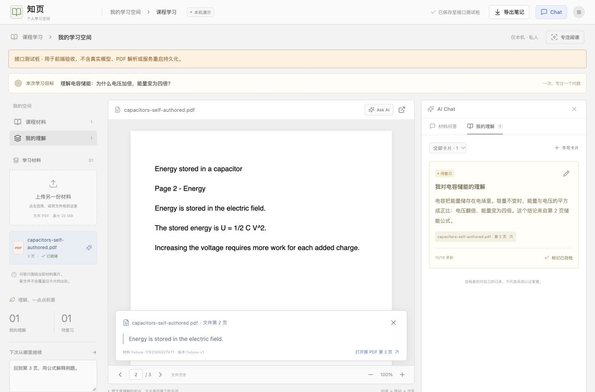

# A 前端交付与验收记录

日期：2026-10-18。范围：`学习Agent-双电脑三小时分工.md` 中 A 的界面、卡片、共用接口及集成准备。**A 前端已实现并测试；B 后端当前未交付，D0 真实闭环未宣称通过。**

## 参考对象与逆向依据

用户指定 [Heptabase Work with AI](https://wiki.heptabase.com/work-with-ai)。实际观察了公开页面 DOM，以及以下两张官方界面截图：

- [白板与 Chat 面板](https://wiki.heptabase.com/assets/images/work-with-ai-02-0853b5a4ba68161514c0abd717d7c462.png)
- [PDF 与 Chat 面板](https://wiki.heptabase.com/assets/images/work-with-ai-07-ed3c9dd0f7c930ca47de694ef44b8e17.png)

可观察：灰色内容区、白色阅读/对话面板、顶部细工具栏、右侧 Chat、输入框的材料上下文、PDF 内 AI 入口、回答引用与卡片化。实现映射为课程材料导航、PDF 阅读、可收起 Chat、明确当前范围、Ask AI 与新建理解卡片。

取舍：三小时任务明确暂不做自由白板、多材料范围、@、模型选择与联网研究。借鉴上述组织方式，将白板承载的成果收敛为理解卡片列表；新增学习目标、手动改写、自检与导出要求。没有添加不能实际工作的菜单或模型下拉框。

未知：公开 Wiki 不提供主应用源码，登录后的内部组件、接口和实现未取得；不能声称复用了 Heptabase 主应用代码。已读取 `reverse-engineer-anything` 技能并运行 REA 6.5.0 doctor：当前会话无 REA MCP 工具；诊断为 Codex REA 注册缺失，现有 Node 25 不在 REA 的支持版本范围。没有修改客户端配置或安装其他运行时；本次证据来自公开网页和截图的浏览器观察，不伪称 REA Evidence 或主程序反编译结果。

## 实现入口

| 内容 | 文件 |
| --- | --- |
| 页面组织、上传、问答、引用与范围 | `frontend/src/App.tsx` |
| 真实接口、超时与结构检查 | `frontend/src/api.ts` |
| 数据结构、卡片状态与 Markdown | `frontend/src/domain.ts` |
| 原 PDF 阅读、翻页、缩放 | `frontend/src/components/PdfReader.tsx` |
| 卡片改写、来源、复习与筛选 | `frontend/src/components/CardsPanel.tsx` |
| 状态加载、串行保存、草稿恢复 | `frontend/src/hooks/useStudyState.ts` |
| 松绿工作区与响应式布局 | `frontend/src/styles.css` |
| 首页、入口路由与设计变量 | `frontend/src/components/LandingPage.tsx`、`frontend/src/Site.tsx`、`frontend/src/tokens.css`、`frontend/src/landing.css` |
| B 联调字段与样例 | `docs/api-contract.md` |
| 安装、运行、真实与隔离测试 | `frontend/README.md` |

## 已执行验证

环境：Node 25.5.0，npm 11.8.0；依赖版本以 lockfile 为准。

- `npm test`：10 个测试通过。覆盖串行请求与新修改合并、旧保存失败时保留最新状态、重试、正文变化重置待复习、来源导出、无效引用、错误状态结构、缺少保存确认、上传错误、错误回答范围、非 JSON 网关错误。
- `npm run build`：TypeScript 检查与 Vite 构建通过。PDF worker、CMaps、字体、WASM 均使用本地资源；无外部字体或图片请求。
- 实际浏览器：使用 5174 页面和 8011 隔离接口桩，始终显示测试标记；正常页面 5173 仍代理真实后端 8000。
- 构建产物预览：4174 页面连接隔离桩，成功恢复材料、第 2 页与卡片，PDF worker 和本地资源实际渲染，浏览器无 error/warn 日志。测试后已停止全部临时服务。

| 浏览器行为 | 观察结果 | 边界 |
| --- | --- | --- |
| 输入目标、上传三页自制 PDF | 显示文件名、三页与状态，原 PDF 实际渲染 | 解析 ready 响应由测试桩提供 |
| 问答和引用 | 请求发出，按段落显示引用；点击到文件第 2 页，摘录可核对 | 回答明确标为测试桩，非模型结果 |
| 草稿改写 | 未改写不能保存；改写后保留来源 | 服务确认仅证明前端响应处理 |
| 自检与再次编辑 | 可标已自检，改正文后变回待复习 | 本人标记，不推断掌握程度 |
| 刷新恢复 | 目标、第 2 页、卡片正文、下次目标恢复 | 测试服务未重启，不证明磁盘持久化 |
| Markdown 导出 | 浏览器实际下载并读回核对正文、待复习、版本、页序和摘录 | 不含原 PDF；仅导出当前提交到状态的卡片 |
| 材料外问题 | 显示依据不足，无引用，无可用的新建卡片按钮 | 条件响应只用于前端验证 |
| 问答失败 | 显示错误，原问题仍在输入框，可重试 | 测试桩返回 502 |
| 保存失败与重试 | 显示失败与草稿保留，最新目标仍在；重试后确认成功 | 测试桩返回 503 后恢复 |
| 专注 | 材料栏收起，退出恢复，阅读与卡片仍在 | 不监控其他软件或时长 |
| 390px 窄屏 | document 内容宽 390 / viewport 390，无页面横向溢出 | 不承诺完整移动编辑体验 |

桌面验收截图（**接口测试桩环境**）：

[窄屏验收截图](screenshots/a-mobile-interface-test.jpg)

## 自制验收材料

`docs/acceptance/capacitors-self-authored.pdf`，共三页，原创英文短讲义，避免额外中文字体环境依赖；源生成器为 `frontend/tests/create-test-pdf.mjs`。主题是电容容量与储能。

- 材料内问题 1：电容的能量储存在哪里？对应第 2 页 “Energy is stored in the electric field.”
- 材料内问题 2：容量不变，电压变成两倍，储能如何变化？第 2 页公式与第 3 页例子。
- 材料外问题：量子计算如何纠错？材料未涵盖，应报告不足。

## B 交付后须执行的真实验收

1. B 按 `docs/api-contract.md` 提供代码、依赖、无密钥配置样例和启动方式；在 A 本机启动，不依赖 B 电脑联网。
2. 使用 5173 的正常页面和 8000 的真实服务，从新上传自制 PDF 开始。
3. 验证真实提取页数；两个不同问题确实请求模型；人工核对主要结论、引用和摘录；材料外问题无捏造来源。
4. 改写保存、标记自检再编辑、刷新；停止并重启 B 服务，原 PDF、目标、阅读位置与卡片仍在。
5. 上传另一份材料，再点击旧卡片来源，验证原材料/版本仍可打开且当前问答范围不被改变。
6. 真实坏 PDF、扫描件、模型失败、存储失败和超时分别显示可读错误，不误报成功。
7. `npm ci && npm test && npm run build` 后用 `npm run preview` 检查构建产物；无密钥入包。按分工文档执行两分钟演示。

以上真实链路项目当前均待 B 交付，不将测试桩截图计为通过证据。

## 2026-10-18 UI 改版补充

已完成「静谧书房」风格接入，补齐中断时缺失的 `landing.css`，统一首页和工作台外观、字号、材料栏展开、阅读／助手切换、来源折叠与流程指引。构建与 10 项单元测试通过；Chrome 八种屏宽布局和核心交互回归通过，无页面脚本错误。详情及新版截图见 [UI 改版验收](UI改版验收.md)。本次交互测试仍使用显著标识的隔离接口桩，不代表真实模型、解析或重启持久化验收通过。
